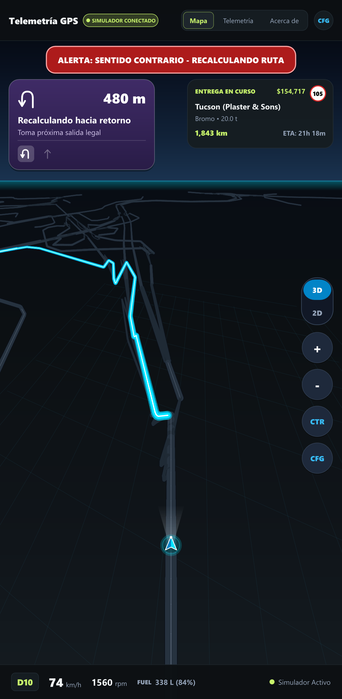
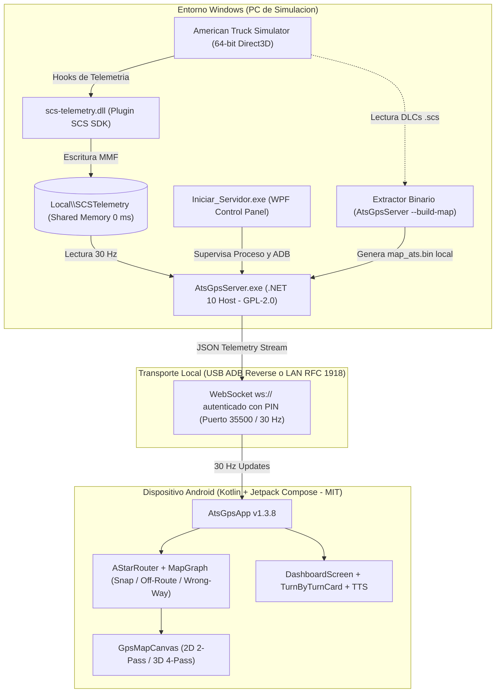

# SGNIA - ATS Telemetry & GPS Companion System

[-00E5FF.svg)](CHANGELOG.md)
[](LICENSE)
[](android/LICENSE)
[](https://dotnet.microsoft.com/)
[](https://kotlinlang.org/)
[](https://developer.android.com/jetpack/compose)
[](https://modding.scssoft.com/wiki/Documentation/Engine/SDK/Telemetry)

Sistema integral de telemetria en cabina, navegacion por satelite (GPS) en tiempo real y panel de instrumentos complementario para **American Truck Simulator** (y compatible con Euro Truck Simulator 2). Desarrollado desde cero bajo arquitectura clean-room, con renderizado por hardware de 60-120 FPS estables sin lag, asistente de voz interactivo, bitacora de viajes y comunicacion directa a 30 Hz por USB (ADB Reverse) o Wi-Fi local.

---

## Galeria Visual (v1.4.0 - Figma Dark OLED)

| Vista 3D en Autopista | Vista 2D Trazo Continuo (Oakland) | Alerta de Sentido Contrario | Tablero de Telemetria | Informacion y Licencias |
| :---: | :---: | :---: | :---: | :---: |
|  |  |  |  |  |
| Proyeccion 3D con pools estaticos sin GC, cinta cian y guia de carriles | Renderizado 2D en 2 pases globales sin costuras internas negras ni micro-conectores | Deteccion en vivo de sentido contrario, alerta visual/TTS y recalculo A* | Velocimetro digital, limite de velocidad, marcha, RPM, desgaste y autonomia | Licencias del proyecto y avisos de componentes de terceros en scroll vertical |

---

## Caracteristicas Principales

### Motor Cartografico Vectorial y Map-Matching
- **Generacion Local On-Demand (`--build-map`):** La base de datos cartografica (`map_ats.bin`, formato `ATSMAP03`) se extrae directamente de los archivos `.scs` instalados en la PC del usuario. No se distribuyen activos propietarios del juego.
- **Cobertura Completa:** Escaneo dinamico via HashFS de `base_map*.scs` y `dlc_*.scs` (147,268 nodos, 653,410 aristas, 168 ciudades, 971 empresas y 2,103 POIs).
- **Map-Matching (`snapToRoad`) Inteligente:** Proyeccion ortogonal con alineacion por rumbo (`headingDeg`) que penaliza carriles opuestos (`4.5x` cuando `dot < -0.35`) y throttling adaptativo que evita calculos redundantes a menos de 1.8 metros.
- **Insignias de POIs Limpias:** Clasificacion tipografica de alto contraste sobre el mapa (`GAS`, `RST`, `SRV`, `DLR`, `LOG`, `WGH`).

### Ruteo A* Estilo ATS, Recalculo Dinamico y Sentido Contrario
- **Costo por Tiempo, Jerarquia y Momento Inicial:** El algoritmo `AStarRouter` pondera la velocidad limite (`105 / speed`), jerarquia de via (autopistas, carreteras principales, calles locales y rampas), semaforos, giros en U (`cosTurn < -0.60`), cruces sinteticos de mediana y momento hacia adelante desde el nodo de origen.
- **Recalculo Automatico Fuera de Ruta:** `evaluateRouteTracking()` en segundo plano (`Dispatchers.Default`). Al confirmar desvio (`> 48 m` o `>= 4` frames fuera de ruta), recalcula la ruta sin bloquear la interfaz.
- **Deteccion y Alerta de Sentido Contrario:** Cuando el vehiculo avanza (`speedKmh > 8` y `gear > 0`) contra el flujo dirigido de la via (`dot < -0.45`) o en sentido opuesto a la ruta activa (`dot < -0.60`), activa el banner de alerta roja, aviso por voz TTS y recalculo hacia retorno legal.

### Rendimiento Extremo y Eliminacion de Lag (v1.4.0)
- **Cero Asignacion Heap en Bucle de Dibujo (Zero GC Churn):** Uso de `RoadSegPool3D` y `RouteSegPool3D` con buffers estaticos pre-alocados y QuickSort in-place sobre indices enteros (`IntArray`).
- **Caché Topologico de Vías:** `Viewport2DCache` y `Viewport3DCache` pre-procesan el encadenado y suavizado de vias solo al moverse entre cuadrantes (> 25 m), manteniendo 60-120 FPS estables.
- **Ruta Activa con Ventana Deslizante $O(1)$:** El trazado suavizado se almacena en memoria y el recorte por progreso se realiza localmente en microsegundos.
- **Temas de Mapa Dinamicos (`STY`):** Selector rapido entre `DARK_PREMIUM`, `HIGH_CONTRAST` (OLED) y `CYBER_NEON`.

### Asistente de Voz y Seguridad en Cabina
- **Guia Giro a Giro por Audio (TTS):** Avisos de maniobra con anticipacion en hitos metricos (1000m, 500m, 200m, 50m) y anuncio de llegada a la ciudad de destino.
- **Alerta de Exceso de Velocidad:** Aviso sonoro y visual cuando la velocidad supera en > 5 km/h el limite legal de la carretera.
- **Alertas Tempranas:** Deteccion de combustible bajo (< 12%) y fatiga de descanso (< 35 min).

### Bitacora de Entregas (Trip Log)
- **Registro de Viajes:** Pestaña dedicada con resumen de ganancias acumuladas, kilometros totales recorridos y bitacora de cargas entregadas con dano e ingresos guardados de forma persistente.

### Instalador Setup de Escritorio (.exe)
- **`Instalador_AtsGps_v1.4.0_Setup.exe`:** Asistente autocontenido que detecta la instalacion de Steam de ATS, copia `scs-telemetry.dll` a la carpeta de plugins, configura el servidor y despliega el APK de Android en un solo paso.

### Renderizador Dual 2D / 3D (Canvas Compose)
- **Vista 3D en Perspectiva:** Cielo crepuscular, resplandor en horizonte (`horizonY = 0.26 * h`), recorte estricto bajo horizonte (`clipRect`), recorte geometrico de segmentos en plano cercano (`projectSegment3D` con `minDepth = 8f`), subdivision de primer plano con suavizado Chaikin, 3 pases globales de carreteras (bordes, asfalto y divisores de carril) y 4 pases globales para la ruta cian iniciando exactamente bajo el cursor del camion.
- **Vista 2D Tactica:** Filtrado de micro-conectores internos de prefab (`roadType == 3 && length < 18f` fuera de ruta), encadenamiento topologico sin plegado inverso (`chainEdges` con rechazo de aristas opuestas `A->B->A`), suavizado Chaikin y 2 pases globales (todos los bordes primero, todos los rellenos unificados encima).
- **Controles e Interpolacion 60-120 Hz:** Interpolacion continua entre frames de telemetria, zoom dinamico por velocidad en 3D, selector `3D / 2D`, zoom tactil (`0.10x` a `4.5x`), desplazamiento libre y botones `CTR` / `CFG`.

### Tablero OLED Figma Dark y Lanzador de Escritorio
- **Tablero de Telemetria (`DashboardScreen`):** Resumen de entrega activa, velocimetro digital, limite de velocidad, marcha (`D1-D18`, `R`, `N`), RPM, 5 canales de desgaste oficial SCS (Neumaticos, Transmision, Motor, Chasis, Cabina), combustible y autonomia con acceso rapido a parada cercana.
- **Lanzador WPF (`AtsGpsLauncher` / `Iniciar_Servidor.exe`):** Panel de escritorio `.NET 10` sin ventana negra de consola con estado HTTP/WS, PIN de emparejamiento, enlace automatico USB `adb reverse tcp:35500 tcp:35500`, instalador de APK en 1 clic y visor de logs UTF-8 en vivo.

---

## Arquitectura del Sistema



---

## Guia de Instalacion y Uso

### 1. Requisitos Previos
- **PC (Windows 10/11 x64):** [.NET 10.0 Runtime o SDK](https://dotnet.microsoft.com/download/dotnet/10.0), *American Truck Simulator* y el plugin `scs-telemetry.dll` ubicado en `bin\win_x64\plugins\scs-telemetry.dll`.
- **Android (8.0+):** Dispositivo conectado por cable USB (Depuracion USB activada) o en la misma red Wi-Fi privada (RFC 1918).

### 2. Generacion Local del Mapa (`--build-map`)
```powershell
dotnet run --project server -- --build-map
```
Genera `server/data/map_ats.bin` directamente desde los archivos `.scs` locales del juego.

### 3. Ejecucion del Servidor y Lanzador PC
Ejecuta `Iniciar_Servidor.exe` (o `Iniciar_Servidor.bat`). El lanzador inicia `AtsGpsServer.exe` en puerto `35500`, configura `adb reverse tcp:35500 tcp:35500` automaticamente al detectar cable USB y muestra el codigo PIN de 6 digitos.

### 4. Instalacion de la App Android
1. Instala `apks/release.apk` (o usa el boton **Instalar APK en Celular** en `Iniciar_Servidor.exe`).
2. Por cable USB la app detecta `127.0.0.1:35500` automaticamente; por Wi-Fi introduce la IP LAN de la PC y el PIN de 6 digitos.

---

## Estructura del Repositorio

```text
GpsATS/
├── Iniciar_Servidor.exe            # Lanzador grafico WPF publicado (.NET 10)
├── Iniciar_Servidor.bat            # Script de arranque CLI y puente ADB
├── CHANGELOG.md                    # Historial detallado de versiones
├── LICENSE                         # Licencia GNU GPL-2.0 (Servidor)
├── LICENSES.md                     # Registro de licencias y terceros
├── README.md                       # Documentacion principal
├── apks/                           # Distribucion de paquetes APK firmados
│   ├── release.apk                 # APK Release v1.4.0 (Build 15)
│   └── AtsGpsApp_v1.4.0.apk        # APK Release versionado
├── docs/
│   └── screenshots/                # Capturas oficiales de v1.4.0 (1080x2200)
├── tools/
│   ├── AtsGpsLauncher/             # Panel de control WPF (.NET 10)
│   └── AtsGpsInstaller/            # Codigo fuente de Instalador Setup autogestionado C#
├── server/                         # Servidor .NET 10 (GPL-2.0)
│   ├── Program.cs                  # Host Kestrel, WebSocket y CLI --build-map
│   ├── Hubs/                       # TelemetryBroadcaster (30 Hz)
│   ├── Map/                        # MapExtractor, MapDataModels, MapBinarySerializer
│   ├── Security/                   # AuthManager (PIN) e IpWhitelistMiddleware (RFC 1918)
│   └── Telemetry/                  # ScsTelemetryReader (MMF) y TelemetrySnapshot
├── android/                        # Aplicacion Android nativa (MIT License)
│   └── app/src/main/java/com/ats/gps/
│       ├── MainActivity.kt         # Loop 30 Hz, recalculo dinamico y alerta wrong-way
│       ├── data/
│       │   ├── map/                # AStarRouter.kt, BinaryMapReader.kt
│       │   ├── model/              # MapGraph.kt (snapToRoad, evaluateRouteTracking)
│       │   ├── network/            # AtsNetworkClient.kt
│       │   └── triplog/            # TripLogManager.kt (registro y persistencia de entregas)
│       └── ui/
│           ├── map/GpsMapCanvas.kt # Renderizador 2D/3D con pools estaticos cero lag
│           ├── navigation/         # TurnByTurnCard.kt con cache O(1) de maniobras
│           ├── dashboard/          # DashboardScreen.kt
│           ├── diagnostic/         # TelemetryDiagnosticScreen.kt
│           ├── junction/           # JunctionView.kt
│           ├── tts/                # NavigationVoiceAssistant.kt
│           ├── triplog/            # TripLogScreen.kt (vista de bitacora y metricas)
│           └── about/              # AboutScreen.kt
└── tests/
    └── AtsGpsServer.Tests/         # Pruebas xUnit (.NET 10)
```

---

## Compilacion desde el Codigo Fuente

### Servidor y Lanzador (.NET 10)
```powershell
dotnet build server/AtsGpsServer.csproj -c Release
dotnet publish tools/AtsGpsLauncher/AtsGpsLauncher.csproj -c Release -r win-x64 --self-contained false -p:PublishSingleFile=true -o .
```

### App Android (Gradle)
```powershell
cd android
./gradlew assembleRelease
```

---

## Licencias y Aspectos Legales
- **Servidor PC (`server/`):** Licenciado bajo **GNU General Public License v2.0 (GPL-2.0)**. Ver [LICENSE](LICENSE).
- **Aplicacion Android (`android/`):** Licenciada bajo **MIT License**. Ver [android/LICENSE](android/LICENSE).
- **Aviso de Marcas:** *American Truck Simulator* y *Euro Truck Simulator 2* son marcas registradas de **SCS Software s.r.o.**. Proyecto independiente de codigo abierto sin afiliacion comercial con SCS Software.
