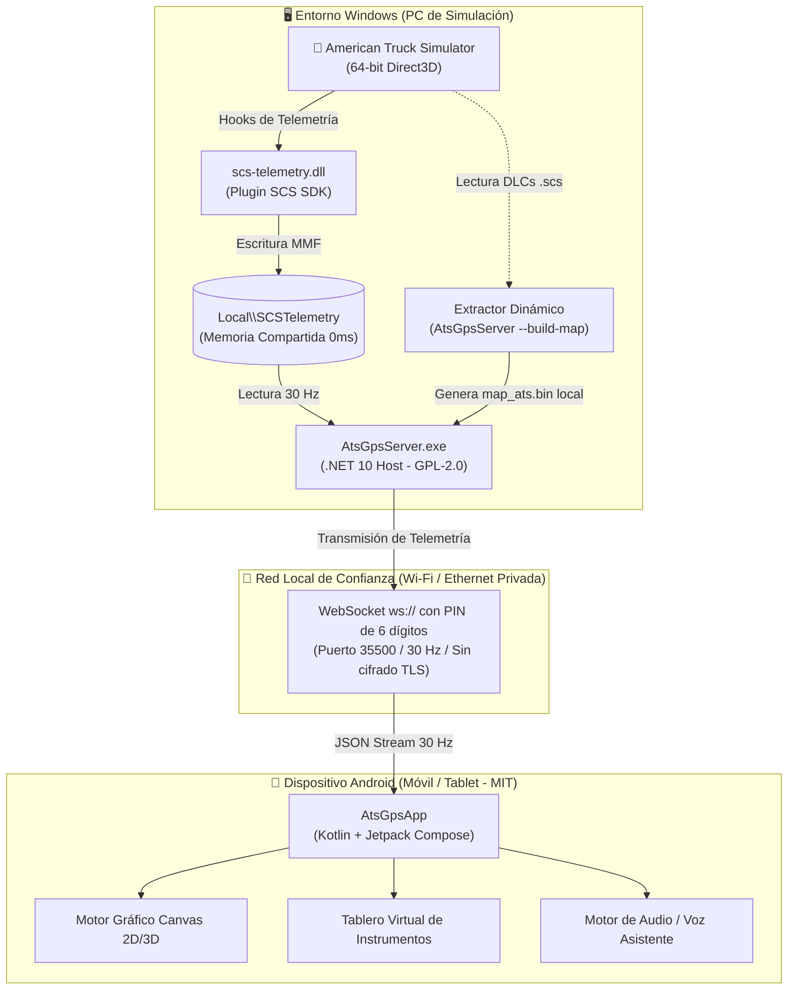

# 🚛 ATS Telemetry GPS & Companion System

[](LICENSE)
[](android/LICENSE)
[](https://dotnet.microsoft.com/)
[](https://www.android.com/)
[](https://dotnet.microsoft.com/)
[](https://kotlinlang.org/)
[](https://developer.android.com/jetpack/compose)
[](https://modding.scssoft.com/wiki/Documentation/Engine/SDK/Telemetry)

Un ecosistema integral de telemetría, navegación por satélite (GPS) en tiempo real y panel de instrumentos complementario para **American Truck Simulator** (y compatible con Euro Truck Simulator 2). Diseñado desde cero bajo principios **clean-room**, de alto rendimiento y baja latencia.

---

## 📸 Vista Previa del Sistema

```text
  +-------------------------------------------------------------------------+
  |                             ATS GPS ACTIVO                [MAPA] [HUD]  |
  +-------------------------------------------------------------------------+
  |  🚚 CONDUCCIÓN LIBRE   LÍMITE 65 MPH                                    |
  |  📍 Cerca de: TACOMA (WA) - Destino: PORTLAND                           |
  |-------------------------------------------------------------------------|
  |                                    |                                    |
  |                                   / \                                   |
  |                                  / ⛽ \   <- Gasolineras & POIs 3D      |
  |                                 /     \                                 |
  |                                /   ▲   \  <- Posición exacta (30 Hz)    |
  |                               /         \                               |
  |                              /     🏢    \ <- Empresas & Entregas       |
  |                             /             \                             |
  |-------------------------------------------------------------------------|
  |  D8  58 km/h  |  Aire: 7.8 bar  |  Combustible: 94%  |  🟢 PC Conectada |
  +-------------------------------------------------------------------------+
```

---

## 🌟 Características Principales

### 🗺️ Motor Cartográfico Vectorial
- **Generación Local On-Demand:** La base de datos cartográfica se extrae directamente de los archivos `.scs` de la instalación local del usuario mediante la herramienta integrada (`--build-map`). Ningún archivo propietario del juego se distribuye en este repositorio.
- **Detección Dinámica de DLCs:** Escaneo dinámico de todos los paquetes `dlc_*.scs` y `base_map*.scs` presentes en la carpeta de American Truck Simulator (Washington, Oregón, California, Nevada, Arizona, Idaho, etc.).
- **Más de 86,000 Nodos y 124,000 Aristas:** Renderizado analítico de curvas Bézier y trazado vectorial continuo.
- **96 Ciudades y 1,321 Puntos de Interés (POIs):**
  - ⛽ **Estaciones de servicio** (Gasolineras)
  - 🛏️ **Áreas de descanso** y Garajes
  - 🔧 **Talleres mecánicos** y mantenimiento
  - 🏬 **Concesionarios oficiales** (Peterbilt, Kenworth, Freightliner, Volvo, etc.)
  - 🏢 **Empresas de logística** y muelles de carga
  - ⚖️ **Básculas de pesaje** de autopista

### 🧭 Navegación Dual: 3D y 2D
- **Perspectiva 3D Chase-Cam:**
  - Proyección focal matemática corregida sobre el camión.
  - Rejilla táctica de perspectiva en el suelo para percepción de velocidad y profundidad.
  - Carteles flotantes (*billboards*) en perspectiva 3D anclados al asfalto.
- **Perspectiva 2D Táctica:**
  - Vista cenital ortográfica con orientación *Heading-Up* (vehículo apuntando hacia arriba) o Norte fijo.
  - Gestos táctiles de pellizco (*pinch-to-zoom* de $0.10\times$ a $4.5\times$), desplazamiento libre (*drag-to-pan*) y botón de recentrado inmediato `[🎯]`.

### 📦 Detección Automática de Carga y Ruteo
- **Sincronización en Vivo:** Detección instantánea de la carga activa (mercancía, peso en toneladas, origen y destino).
- **Ruta Óptima Vectorial:** Cálculo de trayectoria en tiempo real mediante algoritmo $A^*$ vectorial.

### 🪧 Garmin Junction View
- Pantalla de aviso de bifurcación de autopista que anticipa salidas complejas e intercambios de carriles.

### 🎛️ Tablero de Telemetría (HUD Virtual)
- **Monitoreo Mecánico a 30 FPS:**
  - Velocímetro analógico/digital, tacómetro (RPM) y marcha engranada (D1-D18, R1-R4, N).
  - Manómetros de presión de aire del sistema de frenos (con advertencia audible por baja presión) y nivel de combustible.
  - Los 5 canales de desgaste oficiales de SCS: **Cabina, Chasis, Motor, Transmisión y Neumáticos**.
  - Indicadores de luces, intermitentes y freno de estacionamiento.

### 🔒 Conexión y Seguridad en Red Local
- **Memoria Compartida MMF (`Local\SCSTelemetry`):** Lectura directa de telemetría a 0 ms de overhead.
- **WebSocket Autenticado por PIN:** Comunicación bidireccional a 30 Hz vía `ws://` autenticada mediante **código PIN de 6 dígitos**.
  > [!NOTE]
  > La conexión WebSocket funciona sobre HTTP/WS estándar **sin cifrado TLS** y está diseñada estrictamente para **redes locales privadas de confianza (RFC 1918 / LAN)**. El middleware del servidor y el cliente rechazan conexiones provenientes de hosts públicos.

---

## 🏗️ Arquitectura del Sistema



---

## 🚀 Guía de Instalación y Uso

### 1. Requisitos Previos
* **En la PC:**
  - Windows 10 o Windows 11 de 64 bits.
  - [.NET 10.0 Runtime o SDK](https://dotnet.microsoft.com/download/dotnet/10.0).
  - *American Truck Simulator* instalado (a través de Steam u oficial).
  - El plugin `scs-telemetry.dll` instalado en la carpeta de plugins de ATS:
    `C:\Program Files (x86)\Steam\steamapps\common\American Truck Simulator\bin\win_x64\plugins\scs-telemetry.dll`
* **En el Móvil / Tablet:**
  - Dispositivo con Android 8.0 o superior.
  - Conectado a la **misma red Wi-Fi privada** que la PC.

---

### 2. Generación Local del Mapa Vial (`--build-map`)
Por respeto a los derechos de propiedad intelectual de SCS Software, este repositorio **no distribuye archivos binarios de mapas**. Cada usuario genera su archivo `map_ats.bin` localmente a partir de su propia instalación del juego:

1. Abre una terminal en la carpeta del proyecto y ejecuta:
   ```powershell
   dotnet run --project server -- --build-map
   ```
   *(O bien, ejecuta `AtsGpsServer.exe --build-map` si usas el ejecutable publicado).*
2. El extractor escaneará automáticamente todos los DLCs de mapas instalados en tu sistema (`dlc_wa.scs`, `dlc_or.scs`, `dlc_id.scs`, `base_map.scs`, etc.), procesará las curvas viales e intersecciones, y generará el archivo optimizado:
   ```text
   server/data/map_ats.bin
   ```

---

### 3. Iniciar el Servidor
Ejecuta el script de inicio rápido:
```cmd
Iniciar_Servidor.bat
```
La consola mostrará:
```text
================================================================================
          ATS GPS & TELEMETRY SERVER (PC COMPANION - .NET 10)                  
================================================================================

[SEGURIDAD] Código PIN de Emparejamiento: 
  ***********************************
  *          PIN: 481902           *
  ***********************************

[RED LOCAL] Direcciones IP disponibles para conectar desde la App Android:
  -> http://192.168.1.105:35500 (Wi-Fi)
  -> http://127.0.0.1:35500 (Localhost)

[PLUGIN SDK] Verificando scs-telemetry.dll...
  [OK] Plugin scs-telemetry.dll instalado en la carpeta de 64 bits de ATS.

[MAPA] Archivo 'map_ats.bin' disponible: ...\server\data\map_ats.bin
[CONEXIÓN WEBSOCKET]
  Protocolo: ws:// autenticado con PIN (sin cifrado TLS, exclusivo para red local de confianza).

[ESTADO] Servidor en ejecución. Esperando conexiones de la app móvil...
```

---

### 4. Instalación del Cliente Android
1. Descarga el paquete firmado oficial desde [Releases](https://github.com/Gamavg06/GpsATS/releases) junto con su suma de verificación SHA-256.
2. Instálalo en tu dispositivo Android.
3. Abre la app, introduce la **IP local** de tu PC, el puerto (`35500`) y el **código PIN de 6 dígitos**.
4. Pulsa **CONECTAR**. ¡A rodar! 🚚💨

---

## 📂 Estructura del Repositorio

```text
GpsATS/
│
├── Iniciar_Servidor.bat        # Acceso directo para ejecutar el servidor con 1 clic
├── CHANGELOG.md                # Bitácora detallada de versiones y cambios
├── LICENSE                     # Licencia GNU General Public License v2.0 (Servidor)
├── LICENSES.md                 # Registro exhaustivo de licencias y dependencias
├── README.md                   # Documentación principal del proyecto
│
├── third_party/                # Componentes externos y avisos de licencia
│   └── scs_sdk/                # Cabeceras oficiales del SCS Telemetry SDK (Licencia MIT)
│
├── server/                     # Servidor en C# .NET 10 (GPL-2.0)
│   ├── AtsGpsServer.csproj     # Archivo de proyecto .NET 10
│   ├── Program.cs              # CLI (--build-map), Kestrel REST y WebSocket host
│   ├── Hubs/
│   │   └── TelemetryBroadcaster.cs # Transmisión WebSocket a 30 FPS
│   ├── Map/
│   │   ├── MapExtractor.cs     # Extracción dinámica de sectores y DLCs de ATS
│   │   ├── MapManager.cs       # Gestor de caché y compilación de grafo
│   │   ├── MapDataModels.cs    # Estructura de nodos, carreteras y POIs
│   │   └── MapBinarySerializer.cs # Serialización binaria de alta velocidad
│   ├── Security/
│   │   ├── AuthManager.cs      # Autenticación efímera con PIN de 6 dígitos
│   │   └── IpWhitelistMiddleware.cs # Validación estricta de subredes privadas RFC 1918
│   ├── Telemetry/
│   │   ├── ScsTelemetryReader.cs # Lector nativo MMF (Local\SCSTelemetry)
│   │   └── TelemetrySnapshot.cs  # Estructuras de datos de telemetría de juego
│   └── data/                   # Directorio local para map_ats.bin (ignorado por Git)
│
├── android/                    # Aplicación Android nativa (MIT License)
│   ├── LICENSE                 # Licencia MIT para la app Android
│   ├── build.gradle.kts        # Configuración de compilación Gradle
│   └── app/
│       ├── build.gradle.kts    # Dependencias Compose, Material 3, OkHttp
│       └── src/main/java/com/ats/gps/
│           ├── MainActivity.kt # Actividad principal y navegación
│           ├── ui/
│           │   ├── map/GpsMapCanvas.kt # Motor gráfico 2D/3D sobre Canvas
│           │   ├── dashboard/DashboardScreen.kt # Instrumental HUD virtual
│           │   └── junction/GarminJunctionView.kt # Cartelería de autopista
│           └── data/network/AtsNetworkClient.kt # Cliente WebSocket local
│
└── tests/                      # Suite de pruebas automatizadas xUnit (.NET 10)
    └── AtsGpsServer.Tests/     # Pruebas de ruteo A*, serialización y seguridad
```

---

## 🛠️ Compilación desde el Código Fuente

### Servidor .NET 10 (Windows)
```powershell
cd server
dotnet build -c Release
dotnet run -c Release
```

### App Android (Gradle)
```powershell
cd android
./gradlew assembleRelease
```

---

## 📄 Licencia y Aspectos Legales

* **Servidor PC (`server/`):** Publicado bajo la licencia **GNU General Public License v2.0 (GPL-2.0)** debido al uso de la biblioteca `TruckLib` (GPL-2.0). Consulta el archivo [LICENSE](LICENSE).
* **App Móvil (`android/`):** Publicada bajo la licencia permisiva **MIT License**. Consulta el archivo [android/LICENSE](android/LICENSE).
* **Descargo de Marcas:** *American Truck Simulator* y *Euro Truck Simulator 2* son marcas comerciales registradas de **SCS Software s.r.o.**. Este proyecto es un desarrollo independiente de código abierto y no está afiliado, respaldado ni patrocinado por SCS Software.

---

Desarrollado con ❤️ para la comunidad de simulación de transporte. ¡Buenas rutas! 🚛💨
