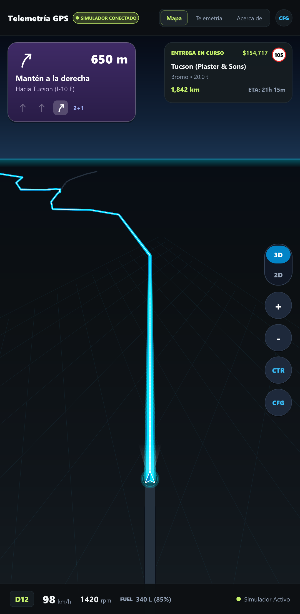
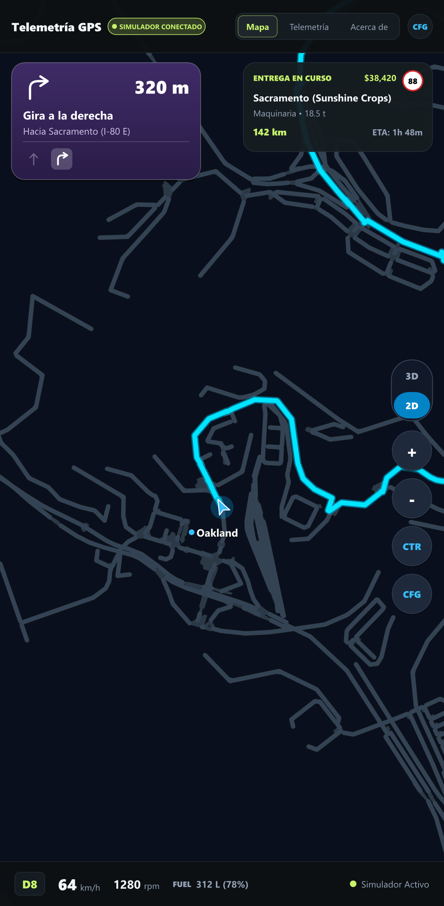
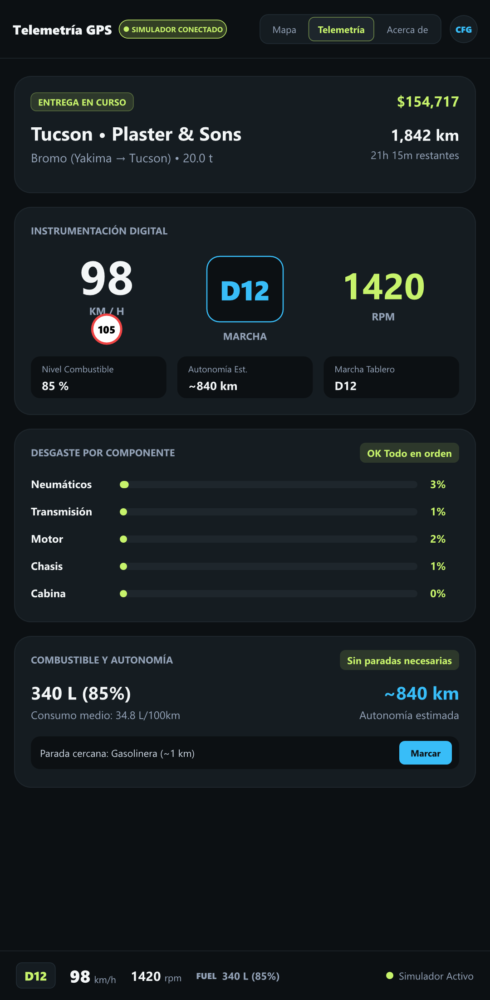
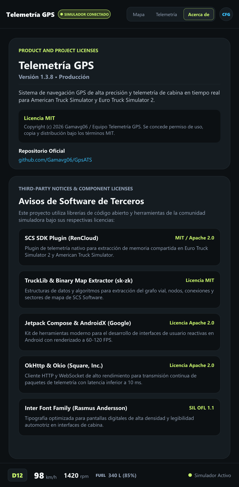
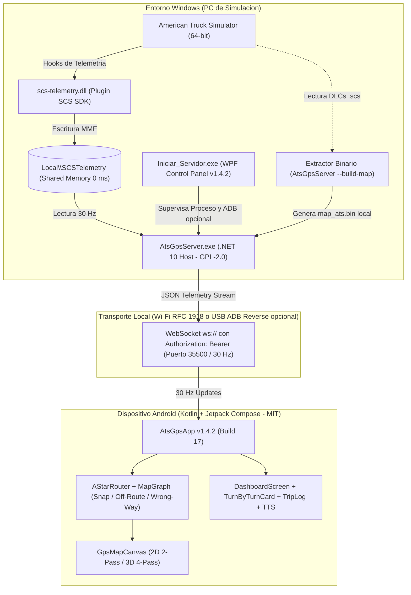

# SGNIA - ATS Telemetry & GPS Companion System

[-00E5FF.svg)](CHANGELOG.md)
[](https://dotnet.microsoft.com/)
[](https://kotlinlang.org/)
[](https://developer.android.com/jetpack/compose)
[](tests/AtsGpsServer.Tests/AtsGpsServer.Tests.csproj)
[](LICENSE)
[](android/LICENSE)

Plataforma integral de telemetria en cabina, navegacion por satelite (GPS) en tiempo real y panel de instrumentos complementario para **American Truck Simulator** (compatible con Euro Truck Simulator 2). Disenada bajo arquitectura clean-room con renderizado por hardware a 60-120 FPS estables, asistente de voz giro a giro, bitacora persistente de entregas y enlace autenticado a 30 Hz en el puerto TCP `35500` por red Wi-Fi privada o cable USB opcional (`adb reverse`).

---

## Autoria y Propiedad del Codigo Fuente

Todo el codigo fuente original de la plataforma **SGNIA - ATS Telemetry & GPS** —incluyendo el servidor de telemetria y extraccion cartografica en `.NET 10` (`server/`), el motor de ruteo `A*` y la aplicacion Android nativa en Jetpack Compose (`android/`), el lanzador grafico de escritorio en WPF (`tools/AtsGpsLauncher/`), el instalador Setup autogestionado (`tools/AtsGpsInstaller/`), la suite de pruebas (`tests/`), scripts y documentacion— ha sido disenado, desarrollado y mantenido integramente por **Gamaliel Velazquez Galicia (SGNIA)**.

Las dependencias y SDKs de terceros utilizados para la lectura de paquetes `.scs`, memoria compartida y utilidades de red/interfaz se mantienen debidamente atribuidos en [`NOTICE`](NOTICE) y en [`LICENSES.md`](LICENSES.md).

---

## Resumen de Componentes

| Componente | Tecnologia | Version | Licencia |
| :--- | :--- | :--- | :--- |
| **Servidor de Telemetria y Mapa** (`server/`) | .NET 10.0 / ASP.NET Core Kestrel / WebSocket (puerto `35500`) | `v1.4.2` | GNU GPL-2.0 ([LICENSE](LICENSE)) |
| **Aplicacion Movil Android** (`android/`) | Kotlin 2.1.0 / Jetpack Compose Canvas / OkHttp | `v1.4.2 (Build 17)` | MIT License ([android/LICENSE](android/LICENSE)) |
| **Lanzador de Escritorio** (`tools/AtsGpsLauncher/`) | .NET 10.0 / WPF (`Iniciar_Servidor.exe`) | `v1.4.2` | MIT License (SGNIA) |
| **Instalador Setup PC** (`tools/AtsGpsInstaller/`) | C# / .NET Framework 4 / Windows Forms | `v1.4.2` | Paquete de distribucion SGNIA ([NOTICE](NOTICE)) |
| **Suite de Pruebas** (`tests/AtsGpsServer.Tests/`) | xUnit / .NET 10.0 | `v1.4.2` | GNU GPL-2.0 |

---

## Galeria Visual (v1.4.2 - Tema Oscuro OLED)

| Vista 3D en Autopista | Vista 2D Trazo Continuo (Oakland) | Alerta de Sentido Contrario | Tablero de Telemetria | Informacion y Licencias |
| :---: | :---: | :---: | :---: | :---: |
|  |  |  |  |  |
| Proyeccion 3D con pools estaticos sin GC, cinta cian y guia de carriles | Renderizado 2D en 2 pases globales sin costuras internas ni micro-conectores | Deteccion en vivo de sentido contrario, alerta visual/TTS y recalculo A* | Velocimetro digital, limite de velocidad, marcha, RPM, desgaste y autonomia | Licencias del proyecto y avisos de componentes de terceros |

---

## Capacidades Tecnicas

### Motor Cartografico Vectorial y Map-Matching
- **Generacion Local sin Redistribucion (`--build-map`):** El archivo `map_ats.bin` (formato binario `ATSMAP03` v3) **NO se distribuye en el repositorio ni en el instalador**. Se genera localmente en la PC del usuario a partir de sus propios archivos `.scs` de *American Truck Simulator* mediante `AtsGpsServer --build-map` (o automaticamente desde el instalador / primer arranque del servidor), escribiendose de forma atomica (`.tmp` + reemplazo seguro) y omitiendo la regeneracion si `map_ats.bin` ya existe con version `ATSMAP03` v3.
- **Cobertura Completa de Mapa:** Escaneo dinamico via HashFS de `base_map*.scs` y `dlc_*.scs` cubriendo **763 sectores**, **278,723 nodos**, **1,275,420 aristas**, **243 ciudades**, **1,708 empresas** y **3,956 POIs**.
- **Geometria Vial y Caminos Ocultos (`RoadType = 5`):** Las polilineas de carretera se extraen mediante **interpolacion lineal de 5 puntos (`Vector3.Lerp`)** entre nodos de origen y destino, con soporte dedicado de extraccion y renderizado 2D/3D para caminos ocultos (`HiddenSecretRoad`) e indicador especifico en `TurnByTurnCard`.
- **Map-Matching (`snapToRoad`) Inteligente:** Proyeccion ortogonal con alineacion por rumbo (`headingDeg`) que penaliza carriles opuestos (`4.5x` cuando `dot < -0.35`) y throttling adaptativo para evitar calculos redundantes en desplazamientos menores a 1.8 m.
- **Insignias de POIs:** Clasificacion tipografica de alto contraste sobre el mapa (`GAS`, `RST`, `SRV`, `DLR`, `LOG`, `WGH`).

### Ruteo A* Transcontinental y Deteccion de Sentido Contrario
- **Heuristica Ponderada y Busqueda Ampliada:** `AStarRouter` pondera velocidad limite (`105 / speed`), jerarquia vial, semaforos, giros en U (`cosTurn < -0.60`), cruces sinteticos de mediana y momento inicial, con limite ampliado a **500,000 pasos** para rutas transcontinentales.
- **Resolucion Normalizada de Destinos:** Emparejamiento exacto priorizado y normalizado entre los nombres de telemetria en vivo y los identificadores de ciudades y empresas del grafo binario (`DestinationResolver` y `MainActivity`).
- **Recalculo Automatico Fuera de Ruta:** Seguimiento continuo mediante flujo conflado en segundo plano (`Dispatchers.Default`); ante desvio confirmado (`> 48 m` o `>= 4` frames fuera de ruta), recalcula sin bloquear el hilo de renderizado.
- **Alerta de Sentido Contrario (Wrong-Way):** Cuando el camion avanza (`speedKmh > 8` y `gear > 0`) contra el sentido dirigido de la via (`dot < -0.45`) o en direccion opuesta a la ruta activa (`dot < -0.60`), activa banner de alerta roja, aviso de voz TTS y recalculo hacia retorno legal.

### Renderizador Dual 2D/3D y Rendimiento de Grado Produccion
- **Cero Asignacion Heap en Bucle de Dibujo:** `RoadSegPool3D` y `RouteSegPool3D` utilizan buffers estaticos pre-asignados y QuickSort in-place sobre indices enteros (`IntArray`), eliminando pausas del Garbage Collector a 60-120 FPS.
- **Cache Topologico de Vias:** `Viewport2DCache` y `Viewport3DCache` pre-procesan el encadenado sin plegados inversos y el suavizado Chaikin al cambiar de cuadrante, con invalidacion automatica ante cambios de grafo o ruta.
- **Ventana Deslizante `O(1)` en Ruta Activa:** El trazado suavizado se conserva en memoria y su recorte por progreso se ejecuta localmente en tiempo `O(1)`.
- **Temas Dinamicos (`STY`):** Alternancia inmediata entre `DARK_PREMIUM`, `HIGH_CONTRAST` (OLED) y `CYBER_NEON`.

### Seguridad Local Estricta, Voz, Bitacora y Portabilidad
- **Validacion de `Origin`, `Host` e IP Privada:** Cualquier peticion con encabezado `Origin` presente recibe `403 Forbidden`. El encabezado `Host` debe corresponder exclusivamente a `localhost`, loopback (`127.0.0.0/8`, `::1`), IPv4 privada RFC 1918 (`10.0.0.0/8`, `172.16.0.0/12`, `192.168.0.0/16`) o IPv6 link-local (`fe80::/10`) / ULA (`fc00::/7`); cualquier otro `Host` o IP publica recibe `403 Forbidden`.
- **PIN Obligatorio y Tokens Bearer (48 h):** `POST /api/pair` exige siempre el PIN de 6 digitos (CSPRNG) sin exenciones para USB, `localhost` o `192.168.42.x`, aplicando bloqueo **por IP** (`429 Too Many Requests` tras 5 fallos durante 2 minutos). Todos los endpoints operativos (`/api/control/key`, `/api/map/*`, `/api/destinations`, `/api/telemetry/snapshot` y el handshake WebSocket `/ws/telemetry`) exigen `Authorization: Bearer <token>` y responden `401 Unauthorized` si falta o es invalido. Ver [SECURITY.md](SECURITY.md).
- **Asistente de Voz TTS y Alertas:** Guia giro a giro por audio en hitos metricos (1000 m, 500 m, 200 m, 50 m), anuncio de llegada y alertas tempranas de exceso de velocidad (`> 5 km/h`), combustible bajo (`< 12%`) y fatiga (`< 35 min`).
- **Bitacora de Entregas (`TripLogScreen`):** Registro cronologico persistente con metricas acumuladas de ingresos, kilometros recorridos y dano por carga.
- **Deteccion Portable de Steam/ATS:** `AtsPathDetector` consulta el Registro de Windows (`HKCU` / `HKLM`), `libraryfolders.vdf` y unidades locales sin depender de rutas fijas de desarrollo.

---

## Arquitectura del Sistema



---

## Guia de Instalacion, Compilacion y Pruebas

### 1. Requisitos Previos
- **PC (Windows 10/11 x64):** [.NET 10.0 Runtime o SDK](https://dotnet.microsoft.com/download/dotnet/10.0), *American Truck Simulator* y `scs-telemetry.dll` ubicado en `bin\win_x64\plugins\scs-telemetry.dll`.
- **Android (8.0+):** Dispositivo conectado en la misma red Wi-Fi privada (RFC 1918) o por cable USB opcional.
- **ADB opcional (solo modo cable USB):** La conexion Wi-Fi funciona sin ADB. Si deseas usar enlace por cable USB (`adb reverse`), descarga **Google Android SDK Platform-Tools** (Apache 2.0) en [developer.android.com/tools/releases/platform-tools](https://developer.android.com/tools/releases/platform-tools) y extrae la carpeta `platform-tools\` junto a `Iniciar_Servidor.exe` o en `%LOCALAPPDATA%\Android\Sdk\platform-tools`. El lanzador WPF detecta `adb.exe` automaticamente y ofrece un enlace directo si no esta instalado.

### 2. Generacion Local del Mapa y Ejecucion en PC
```powershell
# Extraer grafo binario local map_ats.bin desde los .scs instalados en tu PC
dotnet run --project server -- --build-map
```
Ejecuta `Iniciar_Servidor.exe` (o `Iniciar_Servidor.bat`) para iniciar el servidor en el puerto `35500`, configurar `adb reverse tcp:35500 tcp:35500` (si `adb.exe` esta disponible) y visualizar el PIN de 6 digitos obligatorio tanto para Wi-Fi como para USB. En Android, instala el APK oficial `apks/AtsGpsApp_v1.4.2.apk` (la sesion se guarda de forma segura durante 48 horas).

### 3. Compilacion desde el Codigo Fuente y Suite de Pruebas
```powershell
# Compilar servidor y lanzador WPF
dotnet build server/AtsGpsServer.csproj -c Release
dotnet build tools/AtsGpsLauncher/AtsGpsLauncher.csproj -c Release

# Ejecutar suite completa de pruebas xUnit
dotnet test tests/AtsGpsServer.Tests/AtsGpsServer.Tests.csproj

# Publicar servidor y lanzador WPF sin PDB ni ensamblados innecesarios
dotnet publish server/AtsGpsServer.csproj -c Release -o server/publish -p:DebugType=None -p:DebugSymbols=false
dotnet publish tools/AtsGpsLauncher/AtsGpsLauncher.csproj -c Release -r win-x64 --self-contained false -p:PublishSingleFile=true -p:DebugType=None -p:DebugSymbols=false -o tools/AtsGpsLauncher/singlefile

# Compilar aplicacion Android (Release APK)
cd android
.\gradlew.bat compileDebugKotlin assembleRelease --console=plain
```

---

## Estructura del Repositorio

```text
Telemetriagps/
├── Iniciar_Servidor.exe               # Lanzador grafico WPF publicado (.NET 10, v1.4.2)
├── Iniciar_Servidor.bat               # Script de arranque CLI y puente ADB
├── CHANGELOG.md                       # Historial de versiones
├── LICENSE                            # Licencia GNU GPL-2.0 (Servidor)
├── LICENSES.md                        # Autoria y registro legal de dependencias de terceros
├── NOTICE                             # Avisos consolidados UTF-8 y textos de licencia de terceros
├── README.md                          # Documentacion principal del repositorio
├── SECURITY.md                        # Politica de seguridad y arquitectura de acceso local
├── SHA256SUMS                         # Sumas SHA-256 de verificacion de artefactos de distribucion
├── docs/
│   └── screenshots/                   # Capturas oficiales v1.4.2 (1080x2200)
├── third_party/
│   └── scs_sdk/                       # Headers, README y licencia del SCS Telemetry SDK
├── tools/
│   ├── AtsGpsLauncher/                # Panel de control WPF (.NET 10)
│   └── AtsGpsInstaller/               # Codigo fuente del instalador Setup autogestionado C#
├── server/                            # Servidor .NET 10 (GNU GPL-2.0)
│   ├── Program.cs                     # Host Kestrel, endpoints REST/WebSocket y --build-map
│   ├── detect-ats.ps1                 # Script de deteccion portable de Steam / ATS
│   ├── Hubs/                          # TelemetryBroadcaster (30 Hz)
│   ├── Input/                         # VirtualInputController
│   ├── Map/                           # AtsPathDetector, MapExtractor, DestinationResolver, PathFinder, MapBinarySerializer, MapManager
│   ├── Security/                      # AuthManager (PIN/Token), IpWhitelistMiddleware y RequestSecurityMiddleware
│   ├── Telemetry/                     # ScsTelemetryReader (MMF) y TelemetrySnapshot
│   └── plugins/                       # scs-telemetry.dll (RenCloud scs-sdk-plugin, MIT)
├── android/                           # Aplicacion Android nativa (MIT License)
│   ├── LICENSE                        # Licencia MIT de la aplicacion Android
│   └── app/src/main/java/com/ats/gps/
│       ├── MainActivity.kt            # Loop 30 Hz, tracking, recalculo y alerta wrong-way
│       ├── data/
│       │   ├── map/                   # AStarRouter.kt, BinaryMapReader.kt
│       │   ├── model/                 # MapGraph.kt, TelemetryData.kt
│       │   ├── network/               # AtsNetworkClient.kt, AuthTokenStore.kt
│       │   └── triplog/               # TripLogManager.kt
│       └── ui/
│           ├── map/GpsMapCanvas.kt    # Renderizador 2D/3D con pools estaticos sin GC
│           ├── navigation/            # TurnByTurnCard.kt
│           ├── dashboard/             # DashboardScreen.kt, CircularGauge.kt
│           ├── diagnostic/            # TelemetryDiagnosticScreen.kt
│           ├── junction/              # JunctionView.kt
│           ├── tts/                   # NavigationVoiceAssistant.kt
│           ├── triplog/               # TripLogScreen.kt
│           └── about/                 # AboutScreen.kt
└── tests/
    └── AtsGpsServer.Tests/            # Suite de pruebas xUnit (.NET 10)
```

> **Nota sobre artefactos de distribucion y datos del juego:** El instalador autogestionado (`Instalador_AtsGps_v1.4.2_Setup.exe`), el paquete Android compilado (`apks/AtsGpsApp_v1.4.2.apk`) y el mapa binario generado localmente (`server/data/map_ats.bin`) son artefactos excluidos del control de versiones mediante `.gitignore`. El archivo `map_ats.bin` nunca se redistribuye: cada usuario lo genera localmente desde su propia copia de *American Truck Simulator* mediante `--build-map` o el asistente del instalador. Consulta [`SHA256SUMS`](SHA256SUMS) para verificar la integridad de los binarios publicados en los Releases oficiales.

---

## Documentacion Adicional y Aspectos Legales

- **Seguridad:** Consulta [SECURITY.md](SECURITY.md) para detalles sobre autenticacion, aislamiento en red local y reporte de vulnerabilidades.
- **Historial de Cambios:** Consulta [CHANGELOG.md](CHANGELOG.md).
- **Licencias, Avisos y Verificacion:** Consulta [NOTICE](NOTICE), [LICENSES.md](LICENSES.md), [LICENSE](LICENSE), [android/LICENSE](android/LICENSE) y [SHA256SUMS](SHA256SUMS).
- **Aviso de Marcas:** *American Truck Simulator* y *Euro Truck Simulator 2* son marcas registradas de **SCS Software s.r.o.**. Este es un proyecto independiente sin afiliacion comercial con SCS Software.
